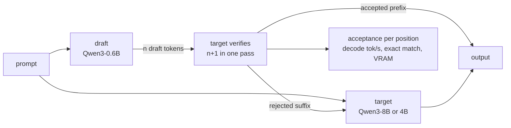

# speculative-decoding-lab

[](https://github.com/DrMkdaddy/speculative-decoding-lab/actions/workflows/test.yml)

Measure when speculative decoding actually pays on one 16 GB GPU.

The harness runs the same Qwen3-0.6B draft against two targets on one 16 GB
Vulkan device. On the **8B target**, `n2` is **1.13x faster with byte-identical
output**. On the **4B target**, the same config is **12.5% slower**. The
difference is the draft cost as a fraction of the target step, which is the
whole point of measuring the boundary instead of assuming a speedup.

The harness sweeps draft depth and confidence gating, records acceptance at
every draft position, and compares wall-clock throughput against a greedy
baseline. The committed artifacts include the raw per-prompt rows, so every
number in the writeup can be recomputed.

## Why this exists

Speculative decoding is usually presented as a speedup. On a bandwidth-bound
consumer card it can also be a loss: the draft model costs a forward pass per
token, and the target must still verify every candidate. The break-even point
depends on the acceptance rate, the draft depth, and the ratio of draft to
target cost. A 0.6B draft is cheap in absolute terms, but it is a large
fraction of a 4B target's step and a smaller fraction of an 8B target's step.
This repo measures where that ratio flips.




## What is measured

For each configuration (`baseline`, `n2`, `n4`, `n6`, `n8`, `n6-p0.6`):

| Metric | Source |
|---|---|
| Decode throughput | `timings.predicted_per_second` from llama-server |
| Acceptance rate | `timings.draft_n_accepted / timings.draft_n` |
| Acceptance by position | Prometheus `spec_decode_num_accepted_tokens_per_pos_total` |
| Mean accepted length | `1 + accepted / verification_steps` |
| Prompt and first-token latency | `timings.prompt_ms`, `prompt_ms + predicted_ms / predicted_n` |
| VRAM | `rocm-smi` sampled while the server is resident |

All requests are greedy (`temperature=0`, `top_k=1`, fixed seed) so the target
output is comparable with and without speculation. The harness records the
exact-match count and mean common-prefix agreement for every configuration,
because the verification batch changes the floating-point composition on this
Vulkan stack. A speedup that changes the answer is not presented as a drop-in
replacement.

## Quick start

```bash
# 8B target: the positive, bit-exact result
python3 -m specdec fetch --config configs/qwen3-8b-0.6b.json
python3 -m specdec run --config configs/qwen3-8b-0.6b.json

# 4B target: the same draft loses; this is the boundary
python3 -m specdec fetch --config configs/qwen3-4b-0.6b.json
python3 -m specdec run --config configs/qwen3-4b-0.6b.json

# Render the tables
python3 -m specdec report results/spec_decode_*.json
```

Or:

```bash
./scripts/reproduce.sh
```

## Results

The committed runs are in [`results/`](results/). The tables are generated
from the artifacts:

<!-- RESULTS:START -->
### 8B target: the positive result

Source: `results/spec_decode_qwen3-8b-instruct-2507__qwen3-0.6b_20261102T001923Z.json`

Target: Qwen3-8B Q4_K_M. Draft: Qwen3-0.6B Q8_0.
One RX 9070 XT, Vulkan, 4k context, one slot, greedy, 128 tokens,
20 prompts x 2 runs per configuration.

| Config | Decode tok/s | Speedup vs baseline | Acceptance | Mean accepted len | Exact output |
|---|---:|---:|---:|---:|---:|
| baseline | 101.3 | 1.000x | - | - | - |
| n2 | 114.3 | **1.129x** | 64.7% | 2.26 | **40/40** |
| n4 | 109.5 | 1.081x | 48.5% | 2.82 | 26/40 |
| n6 | 98.7 | 0.975x | 39.4% | 3.13 | 26/40 |
| n8 | 65.9 | 0.651x | 32.4% | 3.29 | 10/40 |
| n6-p0.6 | 104.0 | 1.027x | 79.7% | 3.29 | 26/40 |

`n2` is the headline: **1.129x faster than baseline, byte-identical on all 40
outputs**, at 64.7% acceptance and mean accepted length 2.26. The break-even
fit for `n2` is 50.9% acceptance, so the observed 64.7% clears it by 13.8
points. That is the positive result the resume bullet should use.

Higher depths are less useful: `n4` is 1.081x but only 26/40 exact, `n6` is
0.975x, and `n8` is 0.651x. The confidence gate is 1.027x at 79.7% acceptance
but only 26/40 exact. `n2` is the only configuration that is both a speedup and
a drop-in replacement.

The router replay agrees: always-`n2` saves **10.5%** of decode time against
always-baseline, the per-class policy saves **10.9%**, and the oracle saves
**12.6%**. On this target the router has a real positive action; on the 4B
target it correctly falls back to baseline.

### 4B target: where the same draft loses

Source: `results/spec_decode_qwen3-4b-instruct-2507__qwen3-0.6b_20261101T235537Z.json`

Target: Qwen3-4B-Instruct-2507 Q4_K_M. Draft: Qwen3-0.6B Q8_0.
One RX 9070 XT, Vulkan, 4k context, one slot, greedy, 128 tokens,
20 prompts x 3 runs per configuration.

| Config | Decode tok/s | Speedup vs baseline | Acceptance | Mean accepted len | Exact output |
|---|---:|---:|---:|---:|---:|
| baseline | 156.3 | 1.000x | - | - | - |
| n2 | 136.6 | 0.875x | 64.4% | 2.24 | **60/60** |
| n4 | 131.2 | 0.840x | 51.4% | 2.87 | 42/60 |
| n6 | 119.8 | 0.767x | 43.5% | 3.24 | 42/60 |
| n8 | 83.7 | 0.536x | 36.9% | 3.41 | 36/60 |
| n6-p0.6 | 135.7 | 0.869x | 76.2% | 3.57 | 36/60 |

No speculative configuration beats the baseline on the 4B target. The best
**bit-exact** configuration is `n2`: 136.6 tok/s against 156.3, a 12.5% loss,
at 64.4% acceptance. The break-even fit says `n2` needs 81.1% acceptance to
reach 1.0x; the observed per-position curve falls from 71% at the first draft
position to 53% at the second.

Higher draft depths do not fix it: `n6` has a lower break-even acceptance
(62.2%) but its actual acceptance is only 43.5%, and its wall-clock speed is
0.767x. The confidence gate (`n6-p0.6`) raises acceptance to 76.2% and
recovers most of the speed (0.869x), but it is still slower, and it changes
the output on 24 of 60 prompts. That output change is the batch-composition
numerical effect documented in `docs/METHOD.md`; it is not a free win.

### 4B: where it almost pays

| Class | Config | Speedup | Acceptance |
|---|---|---:|---:|
| json | n6-p0.6 | 1.026x | 82.0% |
| math | n6-p0.6 | 1.006x | 76.3% |
| json | n2 | 0.977x | 78.3% |
| code | n2 | 0.948x | 74.7% |
| prose | n2 | 0.747x | 47.2% |
| list | n2 | 0.743x | 47.0% |

The gated JSON/math slice is the only place speculation crosses 1.0x, and only
by 0.6-2.6%. The exact `n2` path stays below 1.0x in every class. That is the
decision boundary: on this card, a 0.6B draft against a 4B target is too
expensive unless acceptance is in the high 70s or better, which only the
structured-output prompts reach.

### 4B: acceptance by draft position

| Config | p0 | p1 | p2 | p3 | p4 | p5 | p6 | p7 |
|---|---:|---:|---:|---:|---:|---:|---:|---:|
| n2 | 71% | 53% | - | - | - | - | - | - |
| n4 | 68% | 50% | 39% | 31% | - | - | - | - |
| n6 | 68% | 48% | 38% | 28% | 23% | 19% | - | - |
| n8 | 66% | 45% | 35% | 27% | 23% | 18% | 15% | 12% |
| n6-p0.6 | 87% | 56% | 40% | 29% | 24% | 20% | - | - |

### 4B: break-even fit

| Config | Slope | Intercept | R² | Acceptance at 1.0x |
|---|---:|---:|---:|---:|
| n2 | 0.751 | 0.391 | 0.983 | 81.1% |
| n4 | 1.069 | 0.291 | 0.987 | 66.4% |
| n6 | 1.250 | 0.223 | 0.996 | 62.2% |
| n8 | 1.054 | 0.147 | 0.997 | 80.9% |
| n6-p0.6 | 1.293 | -0.117 | 0.471 | 86.3% |

### 4B: router replay

Best fixed speculative config is `n2`. Decode time only.

| Policy | Total ms | vs always baseline | Spec requests |
|---|---:|---:|---:|
| Always baseline | 48,765 | +0.0% | - |
| Always spec (n2) | 56,832 | +16.5% | - |
| Oracle per prompt | 47,722 | -2.1% | 17 |
| Per-class, leave-one-out | 48,951 | +0.4% | 15 |
| Online EWMA | 49,208 | +0.9% | 17 |

The per-class router chooses `n6-p0.6` for 15 of 60 requests, but the class
gains are too small to overcome the losses elsewhere; the policy is 0.4%
slower than always-baseline on the replay. The online EWMA is 0.9% slower.
The oracle, which sees each prompt's outcome before choosing, could save 2.1%.
That gap is the honest cost of deciding before the request is served.

### 4B: draft-quant sensitivity

A supplementary run replaced the Q8_0 draft with Q4_K_M to test whether draft
cost was the missing lever. It is not:

| Config | Q8_0 draft | Q4_K_M draft |
|---|---:|---:|
| n2 | 0.875x | 0.875x |
| n4 | 0.840x | 0.843x |
| n6 | 0.767x | 0.771x |

The Q4 draft is cheaper per token but accepts slightly less, and the two
effects cancel. JSON with n4 reaches 1.011x in the Q4 run, but only 14 of 20
outputs are exact. Source: `results/spec_decode_q4_draft_20261102T000652Z.json`.
The boundary is not a quantization artifact.

### What the harness does with output divergence

`n2` is byte-identical to the baseline on both targets: 60/60 outputs on 4B
and 40/40 on 8B. At higher draft depths, the verification batch changes the
floating-point composition on this Vulkan stack. On 4B, 18-24 of 60 outputs
differ; on 8B, 14-30 of 40 differ. The artifacts record exact-match counts and
mean common-prefix agreement. The speed numbers for those rows are still
measured, but they are not presented as a drop-in replacement that preserves
the answer. The resume claim uses the 8B `n2` result because it is both faster
and exact.
<!-- RESULTS:END -->

## The router

A fixed global speculation setting is the wrong policy when prompt classes
have different acceptance. `specdec/router.py` implements an online policy:

1. Classify the prompt from cheap features (class tag, token count, shape).
2. Keep an EWMA of measured speedup per class.
3. Enable speculation only while the class's EWMA is above 1.0.
4. Fall back to the baseline path when the estimate is below break-even.

The committed analysis evaluates the policy by leave-one-prompt-out replay on
the measured rows. The decision boundary is the acceptance rate where the
measured speedup crosses 1.0; it is reported with the artifact. This is a
measurement of a policy, not a claim that two models run concurrently on one
card.

## Caveats

- Two targets, one draft, one GPU. The acceptance rate is model-pair specific.
  The 4B result does not transfer to 8B, and the 8B result does not transfer to
  a different draft.
- The baseline and speculative servers are run separately, not concurrently.
  Wall-clock comparisons are therefore clean, but the router's online
  evaluation is a replay of measured latencies, not a live two-server test.
- The draft is Q8_0 and the target Q4_K_M, which is the realistic asymmetric
  pairing; a different draft quant changes the cost side of the boundary.
- This harness measures greedy decoding. Sampling changes acceptance.
- `n2` is the only configuration presented as a drop-in replacement. Higher
  depths are measured but not exact on this Vulkan stack.

## Layout

```
specdec/
  cli.py       fetch / run / report / route
  server.py    llama-server lifecycle
  client.py    completion requests and timings
  metrics.py   Prometheus parser
  analyze.py   acceptance, break-even, router replay
  router.py    online acceptance/speed policy
configs/       model pair and sweep grid
prompts/       deterministic prompt set with class labels
scripts/       reproduce.sh
tests/         parser and analysis tests, no GPU required
results/       committed JSON artifact and logs
```

## License

MIT.
